

  

  <b>One sentence in. A scoped, researched, designed, built and honestly judged prototype out.</b> 
  A team of AI agents on one canvas, for innovation teams deciding which ideas deserve a real budget.

  <a href="#why-spindle">Why Spindle</a> ·
  <a href="#the-pipeline">The pipeline</a> ·
  <a href="#a-look-inside">A look inside</a> ·
  <a href="#what-you-walk-away-with">What you walk away with</a> ·
  <a href="#how-it-works">How it works</a> ·
  <a href="#under-the-hood">Under the hood</a>

---

## Why Spindle

Most ideas die in a slide deck, or get built before anyone checks the market. Spindle runs the full path from idea to evidence: scope, market sizing, design, a working prototype, and a verdict. Every step stays visible, and you can edit any of it.

<table>
  <tr>
    <td width="33%" valign="top">
      <h3>🔎 Evidence, not vibes</h3>
      Market sizes are worked two ways, top-down and bottom-up. Every input carries a source and a grade. Anything the agents can't trace is marked <i>unverified</i>.
    </td>
    <td width="33%" valign="top">
      <h3>🛠️ Built for real</h3>
      The Coding agent writes and runs the app in a cloud sandbox. You get real files, a live preview, a terminal and a zip download, not a mockup.
    </td>
    <td width="33%" valign="top">
      <h3>⚖️ An honest verdict</h3>
      The Scrutinizer argues both sides with the same rigour: a pitch deck for the idea, a limitations deck against it, and a call of <b>Pursue</b>, <b>Pilot</b>, <b>Rethink</b> or <b>Park</b>.
    </td>
  </tr>
</table>

---

## The pipeline


Give the **Orchestrator** your idea. It adds the agents it needs to the canvas, connects them and runs them one at a time. Each agent reads what the earlier ones found.

| Stage | Job | Hands over |
|---|---|---|
| **Project Scoping** | Goal, non-goals, milestones, feasibility, cost and time to an MVP | `scope.md` and a scope report |
| **Market Research** | TAM / SAM / SOM, competitors, a desirability, viability and feasibility (DVF) scorecard | `research.md` and a research report |
| **UX/UI Design** | User flows, screens and every state, built with the Telstra design system | A clickable `prototype.html` |
| **Coding** | Builds the prototype into a working app and tests it | Source code, a running app and a live preview |
| **Scrutinizer** | Judges the product against the research and the running app | A pitch deck, a limitations deck and a verdict |

Quality is checked along the way. After scoping, coding and scrutiny, an **Evaluator** checks the handoff against its brief. A failed check sends that stage back once with the fixes attached. When the research lands, scoping runs again to revise the brief against the findings.

---

## A look inside

### The canvas

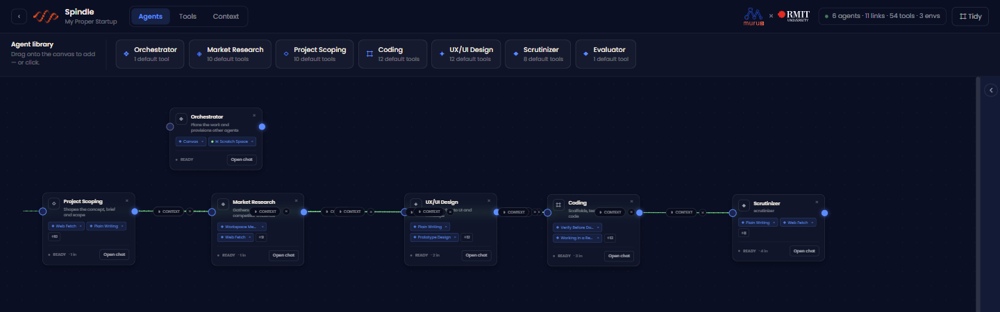

Each project gets its own canvas. Every card is an agent with one job, and every arrow carries context from one agent to the next. Drag a ready-made agent from the library, or let the Orchestrator lay out the whole team for you. The canvas updates live while it works.

### The workspace

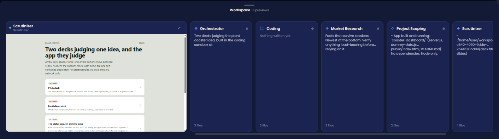

Pull up the workspace drawer for a view of every agent at once: what each one last wrote, how many files it made, and live previews of the pages they published.

### Chat with any agent

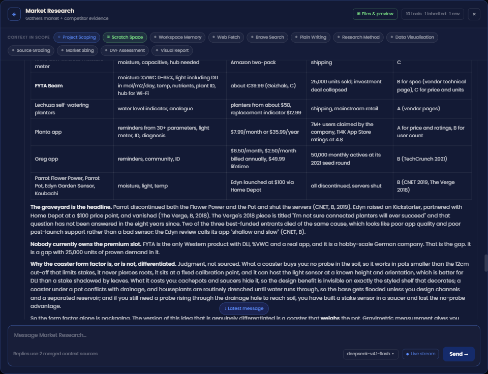

Double-click a card to talk to that agent directly. The chips along the top show everything it can see: the agents feeding it, its sandbox and its tools. Replies stream in, tool calls show as they happen, and you can pick the model per agent.

### Tools and skills

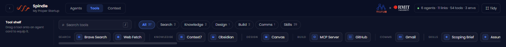

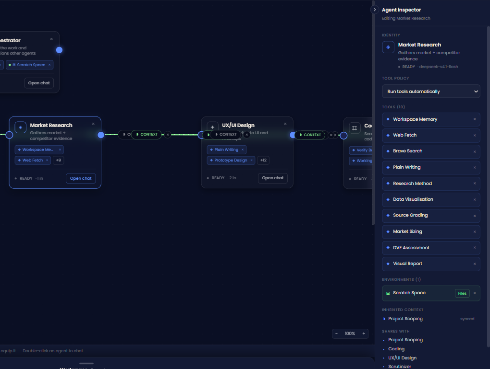

Drop a tool onto a card to equip it: web search, page fetching, GitHub, Gmail, Obsidian, any MCP server, and 29 **skills** such as *Market Sizing*, *DVF Assessment* and *Source Grading*. Click a card to open the inspector and see its tools, its sandbox and where its context comes from. Set the tool policy to *ask first* if you want to approve each call yourself.

### Agents keep notes

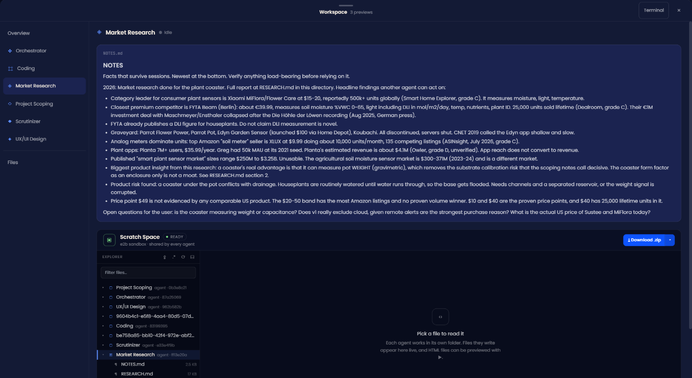

Each agent keeps a `NOTES.md` of facts that should outlive the conversation: decisions, open questions, bugs it found. The next agent, or the next session, picks up from there.

### Files, code and a real terminal

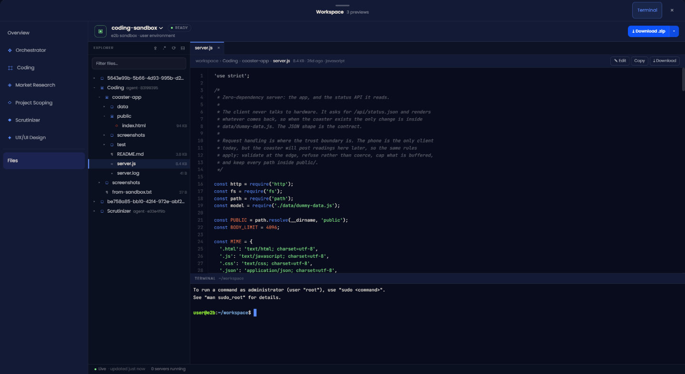

Every agent works in its own folder inside the sandbox. Browse the files as they're written, read the code, open a terminal, and download the whole project as a zip.

---

## What you walk away with

One idea, run end to end. These came out of a single run for a smart plant coaster.

<table>
  <tr>
    <td width="50%" valign="top">
      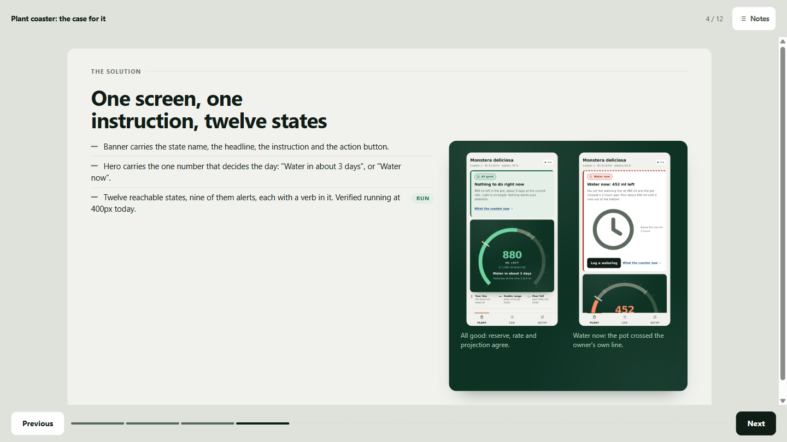
      
<b>The pitch deck</b> The strongest honest case for the idea. Each claim is tagged with its source.

    </td>
    <td width="50%" valign="top">
      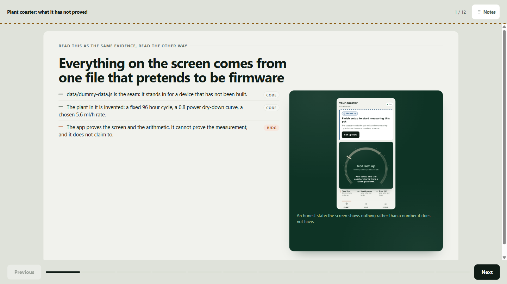
      
<b>The limitations deck</b> The same evidence read the other way, ending in a verdict.

    </td>
  </tr>
  <tr>
    <td colspan="2">
      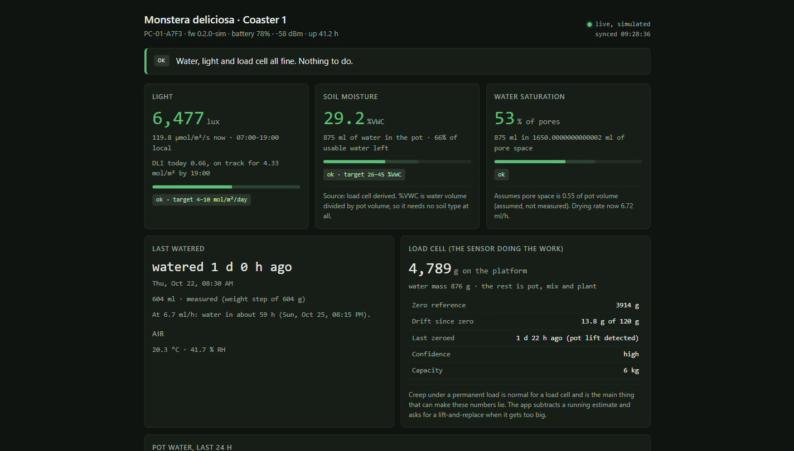
      
<b>The working app</b> Built and running in the sandbox, on simulated data, with tests.

    </td>
  </tr>
</table>

---

## How it works

### Arrows share what an agent knows

An arrow keeps a short **summary** of the source agent's conversation. Before the agent at the other end replies, it reads that summary, so it answers as if it had been in the room.

When the source agent keeps talking, the summary falls behind and the arrow turns orange. It never refreshes on its own, because that would spend money on every message. You choose when to refresh.

### One turn, start to finish

The agent reads its arrows, then starts answering. Partway through it may call a tool: a search, a page fetch, a file in its sandbox. The result goes back to the agent and it keeps writing, sometimes several times in one reply.

If the agent is set to *ask first*, it pauses at the tool and waits for your OK. That pause is saved in the database, so you can approve it minutes later, even after a server restart, and it picks up where it left off.

### Built in

- **Secret keys stay secret.** API keys live encrypted in Supabase Vault. Agents never see them and nobody can read them back.
- **Your projects are yours.** Postgres row-level security filters every query by owner. Someone else's project returns "not found", as if it doesn't exist.
- **A broken tool doesn't break the chat.** A misconfigured tool is reported as unavailable and the agent carries on without it.
- **Bad keys show up early.** Tools are checked when you save them, so a typo turns the card red before a conversation starts.
- **Spend is tracked.** Token usage is recorded per project and per model, with per-user caps.

---

## Under the hood

<table>
  <tr>
    <td><b>Frontend</b></td>
    <td>Next.js 16, React 19, Tailwind</td>
  </tr>
  <tr>
    <td><b>Backend</b></td>
    <td>FastAPI on Python 3.12, Pydantic AI for the agents, DBOS for durable runs</td>
  </tr>
  <tr>
    <td><b>Data and auth</b></td>
    <td>Supabase: Postgres with row-level security, Realtime, Vault and Google sign-in</td>
  </tr>
  <tr>
    <td><b>Sandboxes</b></td>
    <td>E2B cloud sandboxes for files, terminals and live previews</td>
  </tr>
  <tr>
    <td><b>Hosting</b></td>
    <td>Railway</td>
  </tr>
</table>

For every diagram in detail, open [docs/SYSTEM_GUIDE.html](docs/SYSTEM_GUIDE.html) in a browser. The HTTP API is documented in [docs/API.md](docs/API.md).

---

  

  Built by Team 2 for the Telstra muru-D program with RMIT University.

